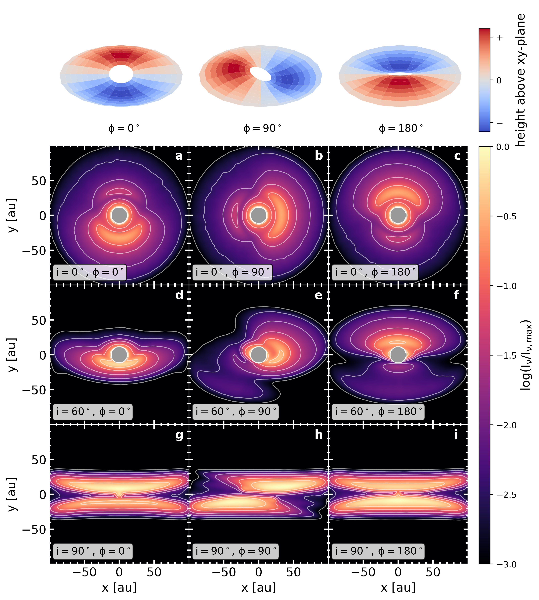

I am a PhD student at the Max Planck Institute for Astronomy in Heidelberg. My curious about the evolution of protoplanetary disks and the processes that ultimately lead to planet formation. For this, I'm using numerical simulations, with a focus on:

1. 3D adaptive grid hydrodynamics
1. Non-ideal magneto-hydrodynamics
1. Radiative transfer

The growth of young terrestrial planets
======
Studying the growth of Super-Earths.

Non-ideal magneto-hydrodynamics (MHD) of the inner protoplanetary disk
======
With analytical temperature profile and magnetic flux transport.

Isothermal-convective atmosphere models and their effect on exoplanetary interiors
======
Creating better training data for the neural network ExoMDN.

Radiative transfer in warped protoplanetary disks
======
Preparing of observations of warped disks.
